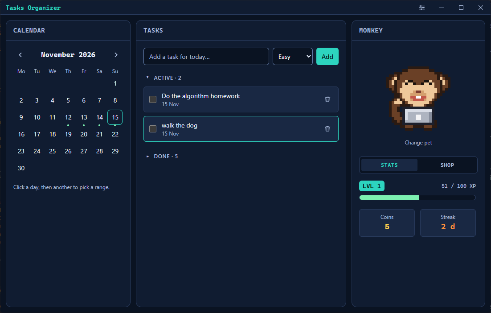
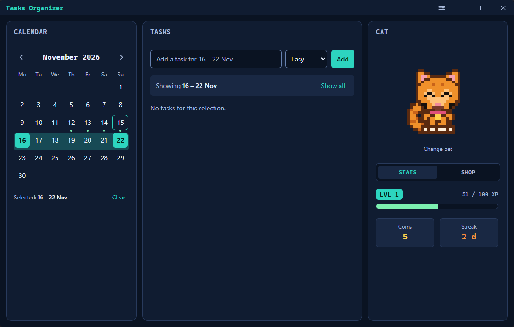
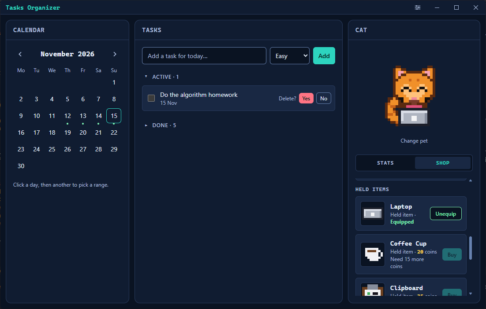
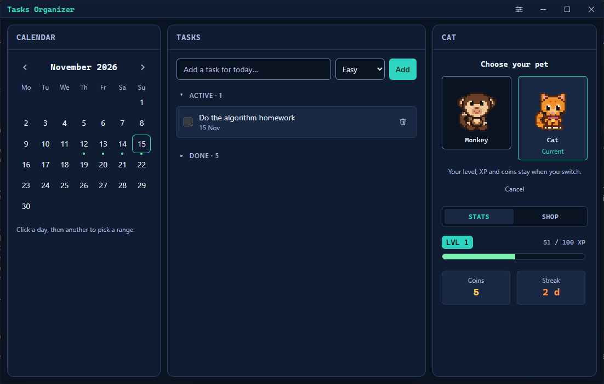
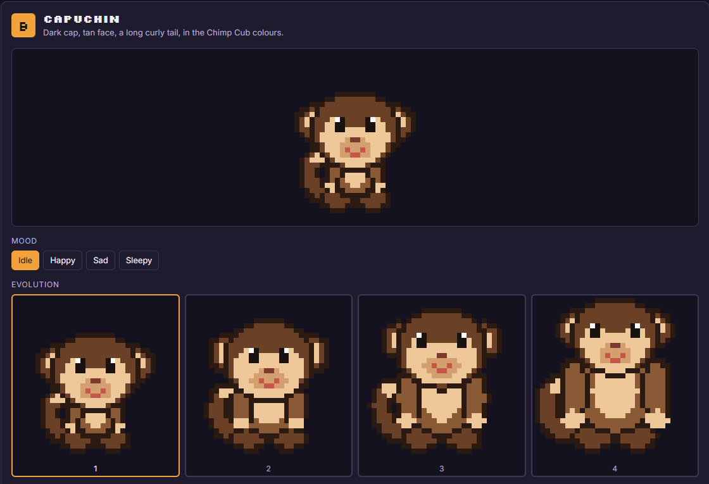
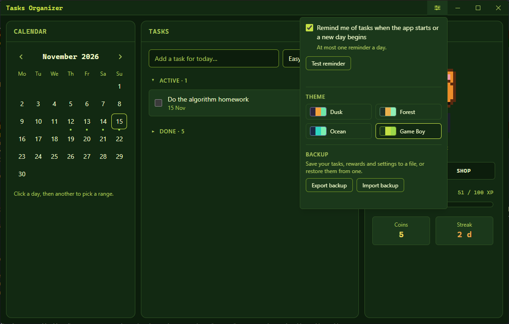

# Tasks Organizer

A gamified desktop task manager for Windows. Plan tasks on a calendar, complete them to earn XP and coins, and watch a retro pixel-art pet level up, evolve and wear the accessories you buy.

> **Status:** version 1.1.0. Phases 0 to 8 of 9 are done: the app is fully playable, lives in the system tray, can back up and restore your data, and builds into a Windows installer. Only the stretch goals (Phase 9) are left. See the [roadmap](#roadmap).

> **Platforms:** Windows 10 and 11. Tauri is cross-platform, so a macOS version is possible, but it is not configured or tested yet.

## Screenshots



*Three panels in one window: the calendar (days with tasks are marked), the task list, and your pet with its level, XP bar, coins and streak. Each task group, Active and Done, can be collapsed from its header, and the app remembers your choice.*



*Click a day, then another, to pick a range. The task list filters to the tasks that overlap it, and "Show all" brings everything back. Here the Orange Tabby cat is the active pet.*



*The Shop tab sits under the pet and groups items by slot. Buying an item equips it right away, and anything you can't afford yet shows how many more coins you need. On the left, deleting a task asks for an inline confirmation; the XP and coins you earned from it stay.*



*Pick a monkey or a cat, and change your mind at any time. Your level, XP and coins belong to you, not the pet.*



*The monkey's pixel art, drawn entirely in code. The pet changes form at levels 5, 10 and 25, so there are four evolution stages, and each one has four moods: idle, happy, sad and sleepy. This is a preview of the art, not a window of the app.*



*The settings menu (the icon in the title bar) holds the daily reminder switch, the theme picker and backup export and import. Pick Dusk, Forest, Ocean or Game Boy and the whole app changes colour straight away; the choice is remembered. Here the app is in the Game Boy theme.*

The first four screenshots use the Ocean theme.

## Features

- **Calendar panel**: select a single day or a range of days; days with tasks are marked. Tasks can only be added from today onwards, and overdue tasks from earlier days can still be completed.
- **Task panel**: active, upcoming and completed tasks, with easy / medium / hard difficulty. Active tasks can be deleted (archived) after an inline confirmation; your earned XP and coins stay. The Active and Done groups collapse from their headers, and the app remembers which are collapsed.
- **Themes**: four colour themes, Dusk (the default), Forest, Ocean and Game Boy, chosen in the settings menu and remembered between runs.
- **Rewards**: each completed task earns XP and coins, with a bonus for daily streaks.
- **Two pets**: pick a monkey or an Orange Tabby cat (and change your mind any time). Level, XP and coins belong to you, not the pet, so switching never loses progress.
- **Evolving character**: the pet levels up with XP and changes form at levels 5, 10 and 25.
- **Moods**: idle, happy, sleepy or sad. The pet is happy for an hour after you complete a task, and for the rest of the day once today's list is done. An overdue task resets your streak and makes it sad until you complete something; you never lose XP or coins.
- **Shop**: spend coins on accessories that fit both pets at every stage. There are twelve items in four slots: three hats (Knit Beanie, Party Hat, Gold Crown), three pairs of glasses (Round, Sunglasses, Monocle), four held items (Laptop, Coffee Cup, Clipboard, Game Controller) and two backgrounds (Night Sky, Sunny Meadow). Buying one equips it, and one item can be worn per slot, so you can wear a hat, glasses, a held item and a background together. Higher-priced items unlock at higher levels. The shop sits in a Stats | Shop tab under the pet and groups the items by slot.
- **Lives in the tray**: the close button hides the window to the system tray. Left-click the tray icon to show or hide it, right-click for Show and Quit. Starting a second copy brings the first one forward.
- **Reminders**: one notification a day, when the app starts or a new day begins, that tells you how many tasks are due today and how many are overdue. It can be turned off in the settings (gear icon in the title bar).
- **New-day aware**: left running for days, the app moves to the new day on its own: it flags tasks that just became overdue and refreshes the pet's mood.
- **Backup and restore**: the settings (gear icon) menu exports everything (tasks, rewards, purchases, settings) to a JSON file and imports it again, on this PC or another. An import is checked completely before anything changes, asks you to confirm, and saves a safety copy of your current data first.
- **Local only**: all data stays in one SQLite file on your machine.

Not built yet: start with Windows, remembering the window size and position, a global shortcut, a compact always-on-top view, code signing and auto-update for the installer, and more shop items.

## Tech stack

| Layer         | Technology                                                                                                  |
| ------------- | ----------------------------------------------------------------------------------------------------------- |
| Desktop shell | [Tauri 2](https://v2.tauri.app/) (Rust, WebView2), tray, notification, single-instance, dialog, fs plugins |
| UI            | React, TypeScript, Vite                                                                                     |
| Styling       | Tailwind CSS 4                                                                                              |
| State         | Zustand                                                                                                     |
| Calendar      | react-day-picker, date-fns                                                                                  |
| Storage       | SQLite via `tauri-plugin-sql`                                                                               |
| Character art | SVG pixel art generated in code (`shape-rendering="crispEdges"`)                                            |
| Tests         | Vitest (game rules, store, backup validation, components)                                                   |

## Architecture

```
components/  ->  store/  ->  domain/        (pure TypeScript game rules)
                        ->  repositories/  ->  SQLite
                        ->  platform/      ->  notifications, file dialogs and files
```

- The UI never talks to the database or the system; it reads state and calls actions on the Zustand store.
- `domain/` holds every XP, level, streak, mood, shop, reminder and backup-validation rule as pure functions, with no React, Tauri or I/O imports and no clock reads, so it is fully unit-tested.
- XP and coins are never stored as counters. They are sums over an append-only `reward_events` ledger; a purchase is a negative-coins event.
- Writes that touch two things (completing a task, buying an item) are ordered, guarded statements that are safe to retry, because the SQL plugin cannot run a transaction across calls.

The full design, schema and interfaces are in [`PLAN.md`](PLAN.md).

## Getting started

### Prerequisites (Windows)

- [Rust](https://rustup.rs/) (stable)
- [Node.js](https://nodejs.org/) LTS
- Microsoft C++ Build Tools with the "Desktop development with C++" workload
- WebView2 (preinstalled on Windows 11)

### Run

```bash
git clone https://github.com/deiu250hz/Task-Organizer.git
cd Task-Organizer
npm install
npm run tauri dev
```

The first build compiles the Rust side and takes a few minutes. Because the close button hides the window to the tray, stop the app with Quit in the tray menu (or Ctrl+C in the terminal).

### Build the installer

```bash
npm run tauri build
```

This produces `src-tauri/target/release/bundle/nsis/Tasks Organizer_1.1.0_x64-setup.exe`, a per-user installer that needs no administrator rights. It is not code-signed, so Windows SmartScreen shows "Windows protected your PC" the first time: choose **More info**, then **Run anyway**. On Windows 10 the installer downloads WebView2 if it is missing. The first build also downloads the NSIS tooling.

Your data lives in `%APPDATA%\com.andre.task-organizer`: the database `tasks.db`, and a `backups` folder with the automatic safety copies made before an import. A development run and an installed copy use the same folder, so they share the same data; export a backup before trying a new build. Uninstalling keeps the data unless you tick the box in the uninstaller.

### Other commands

```bash
npm run dev            # frontend only, in a browser (no Tauri APIs, no database)
npm test               # unit tests (Vitest)
npx tsc --noEmit       # type check
npm run tauri build    # build the Windows installer
```

## Project structure

```
src/
  components/     React UI: layout, calendar, tasks, shop, and the pixel-art character
  store/          Zustand store (actions orchestrate domain + repositories + platform)
  domain/         Pure game rules and their tests
  repositories/   SQL access, the only code that touches the database
  platform/       System features other than SQL (notifications, file dialogs and files)
src-tauri/
  migrations/     Numbered SQL migrations (tasks and ledger, settings, shop, more shop items)
  capabilities/   Tauri permission files
  icons/          App icons, generated from source.png (the monkey's face)
  src/lib.rs      Plugin registration, tray, close-to-tray, single instance
```

## Roadmap

- [x] 0. Toolchain and scaffold
- [x] 1. Window shell and three-panel layout
- [x] 2. SQLite storage and task CRUD
- [x] 3. Calendar with day and range selection
- [x] 4. Gamification engine: XP, levels, streaks
- [x] 5. Pixel-art pets (monkey and cat): 4 evolution stages, moods, animations
- [x] 6. Coin shop and accessories
- [x] 7. Widget behaviour: tray, reminders, single instance, new-day refresh
- [x] 8. Packaging: Windows installer, app icon, backup and restore
- [ ] 9. Stretch: start with Windows, window position, compact view, recurring tasks, weekly stats, more accessories (colour themes are already done)

## License

[MIT](LICENSE)
